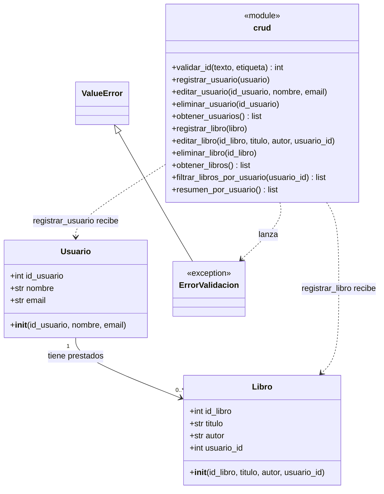
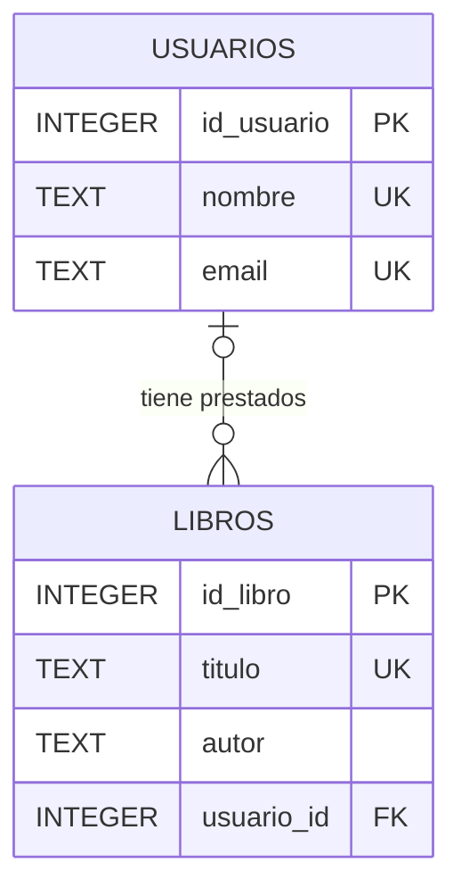

# Manual Técnico — Sistema de Gestión de Biblioteca (EC0835)

**Producto 2.2. Manual técnico del software de aplicación desarrollado**

**Autor:** Alan Escarcega
**Repositorio:** https://github.com/AlanEscarcega/CertificacionEC0835

---

## Índice

1. [Introducción](#1-introducción)
2. [Objetivo general](#2-objetivo-general)
3. [Objetivos específicos](#3-objetivos-específicos)
4. [Requerimientos de instalación](#4-requerimientos-de-instalación)
5. [Diagramas técnicos](#5-diagramas-técnicos)
   - [5.1. Diagrama de clases (UML)](#51-diagrama-de-clases-uml)
   - [5.2. Diagrama entidad-relación (ER)](#52-diagrama-entidad-relación-er)
6. [Desarrollo técnico y código de la aplicación](#6-desarrollo-técnico-y-código-de-la-aplicación)
   - [6.1. Estructura del proyecto](#61-estructura-del-proyecto)
   - [6.2. Base de datos (db.py)](#62-base-de-datos-dbpy)
   - [6.3. Clases del sistema (models.py)](#63-clases-del-sistema-modelspy)
   - [6.4. Lógica de negocio y acceso a datos (crud.py)](#64-lógica-de-negocio-y-acceso-a-datos-crudpy)
   - [6.5. Interfaz gráfica (main.py)](#65-interfaz-gráfica-mainpy)
   - [6.6. Código fuente completo](#66-código-fuente-completo)
7. [Procedimiento de instalación y ejecución](#7-procedimiento-de-instalación-y-ejecución)
8. [Generación del ejecutable](#8-generación-del-ejecutable)

---

## 1. Introducción

El **Sistema de Gestión de Biblioteca** es una aplicación de escritorio desarrollada en **Python**, que modela sus entidades mediante **clases** (programación orientada a objetos) y organiza su lógica en módulos independientes. Utiliza:

- **Tkinter (ttk)** como librería gráfica para la interfaz de usuario.
- **SQLite** como motor de base de datos local, a través del módulo `sqlite3` de la biblioteca estándar de Python.

El sistema permite administrar los **usuarios** de una biblioteca y sus **libros**, y asignar cada libro al usuario que lo tiene prestado. Además, ofrece consultas para filtrar los libros de un usuario y para obtener un resumen con el total de libros por usuario.

El propósito del proyecto es demostrar, en la certificación EC0835, el dominio de las operaciones básicas de programación y de gestión de bases de datos:

- Inserción, selección, actualización y eliminación de registros (CRUD).
- Uso de consultas SQL con `JOIN` y `GROUP BY`.
- Validación de los datos y del funcionamiento a través de la interfaz gráfica y de la base de datos.

---

## 2. Objetivo general

Desarrollar y documentar un sistema CRUD completo para la gestión de usuarios y libros de una biblioteca, capaz de ejecutarse en cualquier equipo con Windows y entregado como producto en formato `.exe`.

---

## 3. Objetivos específicos

- Registrar, editar y eliminar **usuarios**.
- Registrar, editar, eliminar y consultar **libros**.
- Asignar cada libro a un usuario (préstamo) y permitir que un libro quede sin asignar.
- Implementar consultas SQL que:
  - Filtren los libros de un usuario determinado (`WHERE`).
  - Generen un resumen del total de libros por usuario (`LEFT JOIN` y `GROUP BY`).
- Validar los datos de entrada: IDs numéricos de máximo 5 dígitos, campos obligatorios, datos únicos y existencia de los registros relacionados, con mensajes claros para el usuario.
- Garantizar la integridad referencial entre libros y usuarios, y actualizar de forma segura las bases de datos de versiones anteriores mediante un respaldo.
- Entregar el sistema en formato digital y ejecutable (`.exe`).

---

## 4. Requerimientos de instalación

### Hardware mínimo recomendado

| Componente | Requerimiento |
|---|---|
| Procesador | Dual Core 2.0 GHz |
| Memoria RAM | 4 GB |
| Disco | 500 MB libres |

### Software

| Elemento | Requerimiento |
|---|---|
| Sistema operativo | Windows 10 u 11 |
| Python | 3.10 o superior (el sistema se desarrolló y probó con Python 3.13) |
| Tkinter | Incluido con la instalación estándar de Python |
| SQLite | Integrado en Python (módulo `sqlite3`) |
| Dependencias de Python (pip) | `pyinstaller`, solo para generar el ejecutable |

Para **ejecutar únicamente el `.exe`** no se requiere tener Python instalado.

### Dependencias (`requirements.txt`)

```text
pyinstaller
```

> Tkinter y SQLite no se listan porque forman parte de la biblioteca estándar de Python.

---

## 5. Diagramas técnicos

### 5.1. Diagrama de clases (UML)

Las clases `Usuario` y `Libro` representan las entidades del sistema. Una instancia de `Usuario` puede tener **cero o muchos** libros prestados, y cada `Libro` pertenece a **cero o un** usuario (su `usuario_id` es nulo cuando el libro no está prestado).

Las operaciones de registrar, editar, eliminar y consultar se encuentran en el módulo `crud`. Las funciones `registrar_usuario` y `registrar_libro` reciben objetos `Usuario` y `Libro`, mientras que las funciones de edición, eliminación y consulta trabajan con valores individuales (IDs, nombre, título, etc.). Cuando un dato no cumple las reglas del sistema, el módulo lanza la excepción `ErrorValidacion`.



### 5.2. Diagrama entidad-relación (ER)

La base de datos `biblioteca.db` contiene dos tablas. La relación es de **uno a muchos**: un usuario puede tener varios libros, y un libro tiene como máximo un usuario. La llave foránea `usuario_id` utiliza `ON DELETE SET NULL`, por lo que al eliminar un usuario sus libros se conservan y quedan sin asignar.



---

## 6. Desarrollo técnico y código de la aplicación

### 6.1. Estructura del proyecto

El proyecto se organiza en cuatro archivos de código, cada uno con una responsabilidad:

```text
CertificacionEC0835/
│  main.py            # Interfaz gráfica Tkinter y eventos de los botones
│  crud.py            # Funciones CRUD, validaciones y consultas SQL
│  models.py          # Clases Usuario y Libro
│  db.py              # Conexión SQLite, creación de tablas y migración
│  requirements.txt   # Dependencias
│  biblioteca.db      # Base de datos SQLite
│  main.exe           # Ejecutable del sistema
│  Manual_Tecnico.md  # Este documento
```

Flujo general de la aplicación: **`main.py`** (interfaz) → **`crud.py`** (reglas y consultas) → **`db.py`** (conexión) → **`biblioteca.db`**. Los objetos de **`models.py`** se crean en la interfaz y se envían a `crud.py` al registrar usuarios y libros.

### 6.2. Base de datos (db.py)

Este módulo administra la conexión y el esquema de la base de datos.

| Elemento | Descripción |
|---|---|
| `NOMBRE_BD`, `RESPALDO_BD` | Nombres de la base de datos (`biblioteca.db`) y de su respaldo (`biblioteca_respaldo.db`). El archivo se crea en la carpeta desde la que se ejecuta el programa. |
| `get_connection()` | Abre la conexión SQLite y activa `PRAGMA foreign_keys = ON` para que se respeten las llaves foráneas. |
| `SQL_USUARIOS`, `SQL_LIBROS` | Sentencias `CREATE TABLE IF NOT EXISTS` que definen el esquema. |
| `_esquema_viejo()` | Detecta si ya existe una base creada con el esquema anterior (sin `ON DELETE SET NULL`). |
| `_migrar()` | Guarda un respaldo, recrea las tablas con el esquema actual y copia los datos eliminando espacios sobrantes (`TRIM`). Si había datos repetidos conserva el primero (`INSERT OR IGNORE`) e informa cuántos registros se omitieron. |
| `init_db()` | Se ejecuta al iniciar el sistema: migra si es necesario y crea las tablas si no existen. |

**Reglas del esquema**

- Los IDs (`id_usuario`, `id_libro`) los escribe el usuario; no son autoincrementales, por lo que un ID eliminado puede volver a usarse.
- `nombre`, `email` y `titulo` son únicos sin distinguir mayúsculas de minúsculas (`UNIQUE COLLATE NOCASE`).
- `Libros.usuario_id` es una llave foránea hacia `Usuarios.id_usuario` con `ON DELETE SET NULL`.

### 6.3. Clases del sistema (models.py)

| Clase | Atributos | Descripción |
|---|---|---|
| `Usuario` | `id_usuario`, `nombre`, `email` | Representa a una persona registrada en la biblioteca. |
| `Libro` | `id_libro`, `titulo`, `autor`, `usuario_id` | Representa un libro. `usuario_id` indica quién lo tiene prestado y es `None` si está sin asignar. |

Ambas clases inicializan sus atributos mediante el constructor `__init__`.

### 6.4. Lógica de negocio y acceso a datos (crud.py)

Este módulo concentra las operaciones sobre la base de datos y las validaciones.

**Elementos de apoyo**

| Elemento | Descripción |
|---|---|
| `ErrorValidacion` | Excepción (hereda de `ValueError`) con un mensaje listo para mostrarse al usuario. |
| `conexion()` | Administrador de contexto: abre la conexión y entrega un cursor; hace `commit` si todo salió bien, `rollback` si ocurre un error, y siempre cierra la conexión. |
| `validar_id(texto, etiqueta)` | Verifica que el ID sea obligatorio, solo numérico y de máximo 5 dígitos; regresa el ID como entero. |
| `_existe(cur, sql, params)` | Regresa `True` si la consulta encuentra al menos un registro. |

**Funciones CRUD**

| Función | Operación SQL | Validaciones principales |
|---|---|---|
| `registrar_usuario(usuario)` | `INSERT` en `Usuarios` | ID, nombre y email no repetidos. |
| `editar_usuario(id_usuario, nombre, email)` | `UPDATE` en `Usuarios` | El usuario existe; el nombre y el email no pertenecen a otro usuario. |
| `eliminar_usuario(id_usuario)` | `DELETE` en `Usuarios` | El usuario existe. Sus libros quedan sin asignar. |
| `obtener_usuarios()` | `SELECT` en `Usuarios` | Ordenado por ID. |
| `registrar_libro(libro)` | `INSERT` en `Libros` | ID de usuario obligatorio y existente; ID y título no repetidos. |
| `editar_libro(id_libro, titulo, autor, usuario_id)` | `UPDATE` en `Libros` | El libro existe; el título no pertenece a otro libro; `usuario_id` puede ser `None` o debe existir. |
| `eliminar_libro(id_libro)` | `DELETE` en `Libros` | El libro existe. |
| `obtener_libros()` | `SELECT` en `Libros` | Ordenado por ID. |

**Consultas especiales**

- `filtrar_libros_por_usuario(usuario_id)`: obtiene los libros de un usuario con `WHERE usuario_id = ?`.
- `resumen_por_usuario()`: cuenta los libros de cada usuario, incluso de quienes no tienen ninguno:

```sql
SELECT Usuarios.nombre, COUNT(Libros.id_libro)
FROM Usuarios
LEFT JOIN Libros ON Libros.usuario_id = Usuarios.id_usuario
GROUP BY Usuarios.id_usuario
ORDER BY Usuarios.id_usuario
```

Todas las consultas utilizan parámetros (`?`) en lugar de concatenar texto, lo que evita la inyección de SQL. Si SQLite lanza un `IntegrityError` por datos repetidos, se convierte en un `ErrorValidacion` con un mensaje comprensible.

### 6.5. Interfaz gráfica (main.py)

La interfaz se construye con `tkinter` y `ttk`. Al iniciar ejecuta `init_db()` y abre la ventana principal, que contiene:

- Un **encabezado** con el título del sistema.
- Dos **pestañas**: *Usuarios* y *Libros*, cada una con sus campos de captura y sus botones.
- Una **tabla de resultados** (`ttk.Treeview`) con barra de desplazamiento, que cambia sus columnas según la consulta mostrada.

**Funciones principales**

| Función | Descripción |
|---|---|
| `limpiar_campos()` | Borra el contenido de todos los campos de captura. |
| `aviso(error)` | Muestra un cuadro de advertencia con el mensaje del error. |
| `mostrar_tabla(columnas, filas)` | Limpia la tabla y la llena con las columnas y filas recibidas. |
| `mostrar_usuarios_gui()` / `mostrar_libros_gui()` | Consultan y muestran todos los usuarios o libros. Un libro sin asignar se muestra como "Ninguno". |
| `leer_usuario_id_opcional()` | Regresa `None` si el campo está vacío; de lo contrario, valida el ID. |
| `registrar_*_gui()`, `editar_*_gui()`, `eliminar_*_gui()` | Leen y validan los campos, llaman a la función correspondiente de `crud.py` y actualizan la tabla. Si ocurre un `ErrorValidacion`, muestran el aviso sin cerrar el programa. |
| `filtrar_libros_gui()` | Muestra los libros del usuario indicado. |
| `resumen_gui()` | Muestra el total de libros por usuario. |
| `_solo_id(valor)` | Validación en vivo de los campos de ID: solo números y máximo 5 dígitos, también al pegar texto. |

**Comportamientos importantes**

- Al **eliminar un usuario** se pide confirmación y se informa que sus libros no se borran.
- Al **registrar un libro**, el ID de usuario es obligatorio; al **editarlo**, puede dejarse vacío para marcar el libro como "Ninguno".
- Para **editar o eliminar** un registro se escribe su ID en el campo correspondiente.

### 6.6. Código fuente completo

> El código fuente completo se entrega como parte del proyecto en formato `.py`.

#### `db.py`

```python
import os
import shutil
import sqlite3

NOMBRE_BD = "biblioteca.db"
RESPALDO_BD = "biblioteca_respaldo.db"

# ====================
#  Conexion a la base de datos
# ====================


def get_connection():
    con = sqlite3.connect(NOMBRE_BD)
    con.execute("PRAGMA foreign_keys = ON")
    return con


# ====================
#  Esquema
# ====================
# - Los IDs los escribe el usuario (sin AUTOINCREMENT), asi que un ID
#   eliminado puede volver a usarse.
# - nombre, email y titulo son UNIQUE sin distinguir mayusculas/minusculas.
# - Si se elimina un usuario, sus libros quedan sin prestar (usuario_id = NULL).
SQL_USUARIOS = """
CREATE TABLE IF NOT EXISTS Usuarios (
    id_usuario INTEGER PRIMARY KEY,
    nombre TEXT NOT NULL UNIQUE COLLATE NOCASE,
    email TEXT NOT NULL UNIQUE COLLATE NOCASE
)
"""

SQL_LIBROS = """
CREATE TABLE IF NOT EXISTS Libros (
    id_libro INTEGER PRIMARY KEY,
    titulo TEXT NOT NULL UNIQUE COLLATE NOCASE,
    autor TEXT NOT NULL,
    usuario_id INTEGER,
    FOREIGN KEY(usuario_id) REFERENCES Usuarios(id_usuario) ON DELETE SET NULL
)
"""


def _esquema_viejo():
    # True si ya existe una base creada con el esquema anterior
    if not os.path.exists(NOMBRE_BD):
        return False
    con = sqlite3.connect(NOMBRE_BD)
    try:
        fila = con.execute(
            "SELECT sql FROM sqlite_master WHERE type='table' AND name='Libros'"
        ).fetchone()
    finally:
        con.close()
    return fila is not None and "ON DELETE SET NULL" not in fila[0]


def _migrar():
    # Respaldo antes de tocar nada
    shutil.copy2(NOMBRE_BD, RESPALDO_BD)

    con = sqlite3.connect(NOMBRE_BD)
    con.execute("PRAGMA foreign_keys = OFF")
    cur = con.cursor()
    cur.execute("ALTER TABLE Libros RENAME TO Libros_old")
    cur.execute("ALTER TABLE Usuarios RENAME TO Usuarios_old")
    cur.execute(SQL_USUARIOS)
    cur.execute(SQL_LIBROS)

    total_u = cur.execute("SELECT COUNT(*) FROM Usuarios_old").fetchone()[0]
    total_l = cur.execute("SELECT COUNT(*) FROM Libros_old").fetchone()[0]

    # OR IGNORE: si habia nombres, emails o titulos repetidos, se conserva el primero
    cur.execute("""
        INSERT OR IGNORE INTO Usuarios (id_usuario, nombre, email)
        SELECT id_usuario, TRIM(nombre), TRIM(email)
        FROM Usuarios_old ORDER BY id_usuario
    """)
    cur.execute("""
        INSERT OR IGNORE INTO Libros (id_libro, titulo, autor, usuario_id)
        SELECT id_libro, TRIM(titulo), TRIM(autor),
               CASE WHEN usuario_id IN (SELECT id_usuario FROM Usuarios)
                    THEN usuario_id ELSE NULL END
        FROM Libros_old ORDER BY id_libro
    """)

    nuevos_u = cur.execute("SELECT COUNT(*) FROM Usuarios").fetchone()[0]
    nuevos_l = cur.execute("SELECT COUNT(*) FROM Libros").fetchone()[0]

    cur.execute("DROP TABLE Libros_old")
    cur.execute("DROP TABLE Usuarios_old")
    con.commit()
    con.close()

    omitidos = (total_u - nuevos_u) + (total_l - nuevos_l)
    print(f"Base de datos actualizada. Respaldo guardado en {RESPALDO_BD}.")
    if omitidos:
        print(f"Se omitieron {omitidos} registros por tener datos repetidos.")


# ====================
#  Creacion de tablas
# ====================
def init_db():
    if _esquema_viejo():
        _migrar()

    con = get_connection()
    cur = con.cursor()
    cur.execute(SQL_USUARIOS)
    cur.execute(SQL_LIBROS)
    con.commit()
    con.close()
```

#### `models.py`

```python
# ====================
#  Clases del sistema
# ====================


class Usuario:
    def __init__(self, id_usuario, nombre, email):
        self.id_usuario = id_usuario
        self.nombre = nombre
        self.email = email


class Libro:
    def __init__(self, id_libro, titulo, autor, usuario_id):
        self.id_libro = id_libro
        self.titulo = titulo
        self.autor = autor
        self.usuario_id = usuario_id
```

#### `crud.py`

```python
import sqlite3
from contextlib import contextmanager

from db import get_connection


class ErrorValidacion(ValueError):
    """Error con un mensaje listo para mostrarle al usuario."""


@contextmanager
def conexion():
    con = get_connection()
    try:
        yield con.cursor()
        con.commit()
    except Exception:
        con.rollback()
        raise
    finally:
        con.close()


def validar_id(texto, etiqueta="ID"):
    # Obligatorio, solo numeros, maximo 5 digitos
    texto = str(texto).strip()
    if texto == "":
        raise ErrorValidacion(f"El {etiqueta} es obligatorio.")
    if not (texto.isascii() and texto.isdigit()):
        raise ErrorValidacion(f"El {etiqueta} solo puede contener números.")
    if len(texto) > 5:
        raise ErrorValidacion(f"El {etiqueta} puede tener máximo 5 dígitos.")
    return int(texto)


def _existe(cur, sql, params):
    return cur.execute(sql, params).fetchone() is not None


# ========================
# USUARIOS
# ========================


def registrar_usuario(usuario):
    try:
        with conexion() as cur:
            if _existe(
                cur,
                "SELECT 1 FROM Usuarios WHERE id_usuario=?",
                (usuario.id_usuario,),
            ):
                raise ErrorValidacion("Ya existe un usuario con ese ID.")
            if _existe(cur, "SELECT 1 FROM Usuarios WHERE nombre=?", (usuario.nombre,)):
                raise ErrorValidacion("Ya existe un usuario con ese nombre.")
            if _existe(cur, "SELECT 1 FROM Usuarios WHERE email=?", (usuario.email,)):
                raise ErrorValidacion("Ya existe un usuario con ese email.")
            cur.execute(
                "INSERT INTO Usuarios (id_usuario, nombre, email) VALUES (?, ?, ?)",
                (usuario.id_usuario, usuario.nombre, usuario.email),
            )
    except sqlite3.IntegrityError:
        raise ErrorValidacion("Hay datos repetidos (ID, nombre o email).")


def editar_usuario(id_usuario, nombre, email):
    try:
        with conexion() as cur:
            if not _existe(
                cur, "SELECT 1 FROM Usuarios WHERE id_usuario=?", (id_usuario,)
            ):
                raise ErrorValidacion("No existe un usuario con ese ID.")
            if _existe(
                cur,
                "SELECT 1 FROM Usuarios WHERE nombre=? AND id_usuario<>?",
                (nombre, id_usuario),
            ):
                raise ErrorValidacion("Ya existe otro usuario con ese nombre.")
            if _existe(
                cur,
                "SELECT 1 FROM Usuarios WHERE email=? AND id_usuario<>?",
                (email, id_usuario),
            ):
                raise ErrorValidacion("Ya existe otro usuario con ese email.")
            cur.execute(
                "UPDATE Usuarios SET nombre=?, email=? WHERE id_usuario=?",
                (nombre, email, id_usuario),
            )
    except sqlite3.IntegrityError:
        raise ErrorValidacion("Hay datos repetidos (nombre o email).")


def eliminar_usuario(id_usuario):
    # Solo se elimina el usuario; sus libros siguen existiendo y quedan
    # sin prestar (ON DELETE SET NULL en la base de datos).
    with conexion() as cur:
        if not _existe(cur, "SELECT 1 FROM Usuarios WHERE id_usuario=?", (id_usuario,)):
            raise ErrorValidacion("No existe un usuario con ese ID.")
        cur.execute("DELETE FROM Usuarios WHERE id_usuario=?", (id_usuario,))


def obtener_usuarios():
    with conexion() as cur:
        cur.execute(
            "SELECT id_usuario, nombre, email FROM Usuarios ORDER BY id_usuario"
        )
        return cur.fetchall()


# =======================
# LIBROS
# =======================
def registrar_libro(libro):
    # Al registrar, el usuario es obligatorio y debe existir
    if libro.usuario_id is None:
        raise ErrorValidacion("El ID del usuario es obligatorio.")
    try:
        with conexion() as cur:
            if _existe(cur, "SELECT 1 FROM Libros WHERE id_libro=?", (libro.id_libro,)):
                raise ErrorValidacion("Ya existe un libro con ese ID.")
            if _existe(cur, "SELECT 1 FROM Libros WHERE titulo=?", (libro.titulo,)):
                raise ErrorValidacion("Ya existe un libro con ese título.")
            if not _existe(
                cur,
                "SELECT 1 FROM Usuarios WHERE id_usuario=?",
                (libro.usuario_id,),
            ):
                raise ErrorValidacion("El ID de usuario no existe.")
            cur.execute(
                "INSERT INTO Libros (id_libro, titulo, autor, usuario_id) "
                "VALUES (?, ?, ?, ?)",
                (libro.id_libro, libro.titulo, libro.autor, libro.usuario_id),
            )
    except sqlite3.IntegrityError:
        raise ErrorValidacion("Hay datos repetidos (ID o título).")


def editar_libro(id_libro, titulo, autor, usuario_id):
    # usuario_id puede ser None: el libro queda sin prestar ("Ninguno")
    try:
        with conexion() as cur:
            if not _existe(cur, "SELECT 1 FROM Libros WHERE id_libro=?", (id_libro,)):
                raise ErrorValidacion("No existe un libro con ese ID.")
            if _existe(
                cur,
                "SELECT 1 FROM Libros WHERE titulo=? AND id_libro<>?",
                (titulo, id_libro),
            ):
                raise ErrorValidacion("Ya existe otro libro con ese título.")
            if usuario_id is not None and not _existe(
                cur, "SELECT 1 FROM Usuarios WHERE id_usuario=?", (usuario_id,)
            ):
                raise ErrorValidacion("El ID de usuario no existe.")
            cur.execute(
                "UPDATE Libros SET titulo=?, autor=?, usuario_id=? WHERE id_libro=?",
                (titulo, autor, usuario_id, id_libro),
            )
    except sqlite3.IntegrityError:
        raise ErrorValidacion("Hay datos repetidos (título).")


def eliminar_libro(id_libro):
    with conexion() as cur:
        if not _existe(cur, "SELECT 1 FROM Libros WHERE id_libro=?", (id_libro,)):
            raise ErrorValidacion("No existe un libro con ese ID.")
        cur.execute("DELETE FROM Libros WHERE id_libro=?", (id_libro,))


def obtener_libros():
    with conexion() as cur:
        cur.execute(
            "SELECT id_libro, titulo, autor, usuario_id FROM Libros ORDER BY id_libro"
        )
        return cur.fetchall()


# =======================
# FILTRO Y RESUMEN
# =======================


def filtrar_libros_por_usuario(usuario_id):
    with conexion() as cur:
        cur.execute(
            "SELECT id_libro, titulo, autor, usuario_id FROM Libros "
            "WHERE usuario_id=? ORDER BY id_libro",
            (usuario_id,),
        )
        return cur.fetchall()


def resumen_por_usuario():
    with conexion() as cur:
        cur.execute("""
            SELECT Usuarios.nombre, COUNT(Libros.id_libro)
            FROM Usuarios
            LEFT JOIN Libros ON Libros.usuario_id = Usuarios.id_usuario
            GROUP BY Usuarios.id_usuario
            ORDER BY Usuarios.id_usuario
        """)
        return cur.fetchall()
```

#### `main.py`

```python
import tkinter as tk
from tkinter import ttk, messagebox

from db import init_db
from models import Usuario, Libro
from crud import (
    ErrorValidacion,
    validar_id,
    registrar_usuario,
    editar_usuario,
    eliminar_usuario,
    obtener_usuarios,
    registrar_libro,
    editar_libro,
    eliminar_libro,
    obtener_libros,
    filtrar_libros_por_usuario,
    resumen_por_usuario,
)

# Inicializar base (si es de una version anterior, la actualiza)
init_db()


###############################
# Funciones auxiliares
###############################
def limpiar_campos():
    for entrada in (
        entry_id_usuario,
        entry_nombre,
        entry_email,
        entry_id_libro,
        entry_titulo,
        entry_autor,
        entry_usuario_id,
    ):
        entrada.delete(0, tk.END)


def aviso(error):
    messagebox.showwarning("Aviso", str(error))


def mostrar_tabla(columnas, filas):
    # Limpia la tabla y la vuelve a llenar con las columnas y filas recibidas
    tabla.delete(*tabla.get_children())
    tabla["columns"] = columnas
    for col in columnas:
        tabla.heading(col, text=col)
        tabla.column(col, width=130, anchor="center")
    for fila in filas:
        tabla.insert("", tk.END, values=fila)


def mostrar_usuarios_gui():
    mostrar_tabla(("ID", "Nombre", "Email"), obtener_usuarios())


def mostrar_libros_gui(registros=None):
    if registros is None:
        registros = obtener_libros()
    filas = []
    for r in registros:
        usuario = r[3] if r[3] is not None else "Ninguno"
        filas.append((r[0], r[1], r[2], usuario))
    mostrar_tabla(("ID", "Título", "Autor", "ID Usuario"), filas)


def leer_usuario_id_opcional():
    # None si el campo está vacío; si no, lo valida como ID
    if entry_usuario_id.get().strip() == "":
        return None
    return validar_id(entry_usuario_id.get(), "ID del usuario")


###############################
# Eventos de usuarios
###############################
def registrar_usuario_gui():
    try:
        id_usuario = validar_id(entry_id_usuario.get(), "ID")
        nombre = entry_nombre.get().strip()
        email = entry_email.get().strip()
        if not nombre or not email:
            raise ErrorValidacion("Escribe nombre y email.")
        registrar_usuario(Usuario(id_usuario, nombre, email))
    except ErrorValidacion as e:
        aviso(e)
        return
    limpiar_campos()
    mostrar_usuarios_gui()


def editar_usuario_gui():
    try:
        id_usuario = validar_id(entry_id_usuario.get(), "ID")
        nombre = entry_nombre.get().strip()
        email = entry_email.get().strip()
        if not nombre or not email:
            raise ErrorValidacion("Escribe el nombre y el email.")
        editar_usuario(id_usuario, nombre, email)
    except ErrorValidacion as e:
        aviso(e)
        return
    limpiar_campos()
    mostrar_usuarios_gui()


def eliminar_usuario_gui():
    try:
        id_usuario = validar_id(entry_id_usuario.get(), "ID")
        if not messagebox.askyesno(
            "Confirmar",
            f"¿Eliminar al usuario {id_usuario}?\n"
            "Sus libros no se borran: quedarán sin prestar.",
        ):
            return
        eliminar_usuario(id_usuario)
    except ErrorValidacion as e:
        aviso(e)
        return
    limpiar_campos()
    mostrar_usuarios_gui()


###############################
# Eventos de libros
###############################
def registrar_libro_gui():
    try:
        id_libro = validar_id(entry_id_libro.get(), "ID del libro")
        titulo = entry_titulo.get().strip()
        autor = entry_autor.get().strip()
        if not titulo or not autor:
            raise ErrorValidacion("Escribe título y autor.")
        # Obligatorio al registrar
        usuario_id = validar_id(entry_usuario_id.get(), "ID del usuario")
        registrar_libro(Libro(id_libro, titulo, autor, usuario_id))
    except ErrorValidacion as e:
        aviso(e)
        return
    limpiar_campos()
    mostrar_libros_gui()


def editar_libro_gui():
    try:
        id_libro = validar_id(entry_id_libro.get(), "ID del libro")
        titulo = entry_titulo.get().strip()
        autor = entry_autor.get().strip()
        if not titulo or not autor:
            raise ErrorValidacion("Escribe título y autor.")
        # Vacío = libro sin prestar ("Ninguno")
        usuario_id = leer_usuario_id_opcional()
        editar_libro(id_libro, titulo, autor, usuario_id)
    except ErrorValidacion as e:
        aviso(e)
        return
    limpiar_campos()
    mostrar_libros_gui()


def eliminar_libro_gui():
    try:
        id_libro = validar_id(entry_id_libro.get(), "ID del libro")
        eliminar_libro(id_libro)
    except ErrorValidacion as e:
        aviso(e)
        return
    limpiar_campos()
    mostrar_libros_gui()


def filtrar_libros_gui():
    try:
        usuario_id = validar_id(entry_usuario_id.get(), "ID del usuario")
    except ErrorValidacion as e:
        aviso(e)
        return
    mostrar_libros_gui(filtrar_libros_por_usuario(usuario_id))


def resumen_gui():
    mostrar_tabla(("Usuario", "Total de libros"), resumen_por_usuario())


###############################
# Ventana principal
###############################
ventana = tk.Tk()
ventana.title("Sistema de Biblioteca")
ventana.geometry("860x620")
ventana.configure(bg="#f4f1ea")

estilo = ttk.Style()
estilo.theme_use("clam")
estilo.configure("TNotebook", background="#f4f1ea")
estilo.configure("TFrame", background="#ffffff")
estilo.configure("TLabel", background="#ffffff", font=("Segoe UI", 10))
estilo.configure("TButton", font=("Segoe UI", 10), padding=6)
estilo.configure("Treeview", rowheight=26, font=("Segoe UI", 10))
estilo.configure("Treeview.Heading", font=("Segoe UI", 10, "bold"))


# Los campos de ID solo aceptan números y máximo 5 dígitos (también al pegar)
def _solo_id(valor):
    return valor == "" or (valor.isascii() and valor.isdigit() and len(valor) <= 5)


vcmd_id = (ventana.register(_solo_id), "%P")

# ---- Encabezado ----
encabezado = tk.Label(
    ventana,
    text="Sistema de Biblioteca",
    font=("Segoe UI", 20, "bold"),
    bg="#6b4226",
    fg="white",
    pady=14,
)
encabezado.pack(fill="x")

# ---- Pestañas ----
pestanas = ttk.Notebook(ventana)
pestanas.pack(fill="x", padx=15, pady=15)

tab_usuarios = ttk.Frame(pestanas, padding=15)
tab_libros = ttk.Frame(pestanas, padding=15)
pestanas.add(tab_usuarios, text="  Usuarios  ")
pestanas.add(tab_libros, text="  Libros  ")

###############################
# Pestaña Usuarios
###############################
ttk.Label(tab_usuarios, text="ID").grid(row=0, column=0, sticky="w", padx=5)
ttk.Label(tab_usuarios, text="Nombre").grid(row=0, column=1, sticky="w", padx=5)
ttk.Label(tab_usuarios, text="Email").grid(row=0, column=2, sticky="w", padx=5)

entry_id_usuario = ttk.Entry(
    tab_usuarios, width=10, validate="key", validatecommand=vcmd_id
)
entry_id_usuario.grid(row=1, column=0, padx=5, pady=5)
entry_nombre = ttk.Entry(tab_usuarios, width=25)
entry_nombre.grid(row=1, column=1, padx=5, pady=5)
entry_email = ttk.Entry(tab_usuarios, width=30)
entry_email.grid(row=1, column=2, padx=5, pady=5)

ttk.Button(tab_usuarios, text="Registrar", command=registrar_usuario_gui).grid(
    row=2, column=0, pady=10, padx=5
)
ttk.Button(tab_usuarios, text="Editar", command=editar_usuario_gui).grid(
    row=2, column=1, pady=10, padx=5
)
ttk.Button(tab_usuarios, text="Eliminar", command=eliminar_usuario_gui).grid(
    row=2, column=2, pady=10, padx=5
)
ttk.Button(tab_usuarios, text="Mostrar todos", command=mostrar_usuarios_gui).grid(
    row=2, column=3, pady=10, padx=5
)

###############################
# Pestaña Libros
###############################
ttk.Label(tab_libros, text="ID Libro").grid(row=0, column=0, sticky="w", padx=5)
ttk.Label(tab_libros, text="Título").grid(row=0, column=1, sticky="w", padx=5)
ttk.Label(tab_libros, text="Autor").grid(row=0, column=2, sticky="w", padx=5)
ttk.Label(tab_libros, text="ID Usuario").grid(row=0, column=3, sticky="w", padx=5)

entry_id_libro = ttk.Entry(tab_libros, width=8, validate="key", validatecommand=vcmd_id)
entry_id_libro.grid(row=1, column=0, padx=5, pady=5)
entry_titulo = ttk.Entry(tab_libros, width=22)
entry_titulo.grid(row=1, column=1, padx=5, pady=5)
entry_autor = ttk.Entry(tab_libros, width=18)
entry_autor.grid(row=1, column=2, padx=5, pady=5)
entry_usuario_id = ttk.Entry(
    tab_libros, width=10, validate="key", validatecommand=vcmd_id
)
entry_usuario_id.grid(row=1, column=3, padx=5, pady=5)

ttk.Button(tab_libros, text="Registrar", command=registrar_libro_gui).grid(
    row=2, column=0, pady=10, padx=3
)
ttk.Button(tab_libros, text="Editar", command=editar_libro_gui).grid(
    row=2, column=1, pady=10, padx=3
)
ttk.Button(tab_libros, text="Eliminar", command=eliminar_libro_gui).grid(
    row=2, column=2, pady=10, padx=3
)
ttk.Button(tab_libros, text="Mostrar todos", command=mostrar_libros_gui).grid(
    row=2, column=3, pady=10, padx=3
)
ttk.Button(tab_libros, text="Filtrar por usuario", command=filtrar_libros_gui).grid(
    row=2, column=4, pady=10, padx=3
)
ttk.Button(tab_libros, text="Resumen", command=resumen_gui).grid(
    row=2, column=5, pady=10, padx=3
)

###############################
# Tabla de resultados
###############################
frame_tabla = ttk.LabelFrame(ventana, text="Resultados", padding=10)
frame_tabla.pack(fill="both", expand=True, padx=15, pady=(0, 15))

tabla = ttk.Treeview(frame_tabla, show="headings", height=10)
barra = ttk.Scrollbar(frame_tabla, orient="vertical", command=tabla.yview)
tabla.configure(yscrollcommand=barra.set)
tabla.pack(side="left", fill="both", expand=True)
barra.pack(side="right", fill="y")

ventana.mainloop()
```

---

## 7. Procedimiento de instalación y ejecución

1. Clonar o descargar el proyecto:

   ```powershell
   git clone https://github.com/AlanEscarcega/CertificacionEC0835.git
   cd CertificacionEC0835
   ```

2. Crear y activar el entorno virtual:

   ```powershell
   python -m venv venv
   venv\Scripts\activate
   ```

   Si PowerShell bloquea la activación, ejecutar antes `Set-ExecutionPolicy -Scope Process -ExecutionPolicy RemoteSigned`.

3. Instalar las dependencias:

   ```powershell
   pip install -r requirements.txt
   ```

4. Ejecutar el sistema:

   ```powershell
   python main.py
   ```

Al iniciar por primera vez se crea el archivo `biblioteca.db` en la carpeta del proyecto. Si ya existe una base de datos de una versión anterior, el sistema la actualiza y guarda una copia en `biblioteca_respaldo.db`.

---

## 8. Generación del ejecutable

1. Instalar PyInstaller (con el entorno virtual activo):

   ```powershell
   pip install pyinstaller
   ```

2. Crear el `.exe`:

   ```powershell
   pyinstaller --onefile main.py
   ```

3. El ejecutable se genera en la carpeta `dist\main.exe`. En el repositorio se incluye una copia lista para usar como `main.exe`.

4. Copiar la base de datos `biblioteca.db` a la misma carpeta que el ejecutable para conservar los datos registrados. Si no existe, el sistema crea una base vacía en la carpeta desde la que se ejecuta.

5. Validar la ejecución en un equipo sin Python instalado, comprobando cada uno de los flujos: registrar, editar y eliminar usuarios y libros, filtrar por usuario y generar el resumen.
