## Portada

**Universidad:** Cesun Universidad

**Certificación:** EC0835

**Producto:** 2.3 Manual de usuario

**Alumno:** Alan Felipe Escárcega Domínguez

**Grupo:** 010IDPRMA

**Carrera:** Ing. Desarrollo de software

---

## Título

**Manual de Usuario del Sistema de Gestión de Biblioteca**

---

## Introducción

El **Sistema de Gestión de Biblioteca** es un programa para computadora con Windows que sirve para llevar el control de los **usuarios** de una biblioteca y de los **libros** que se les prestan. Está dirigido a la persona encargada de administrar los préstamos de una biblioteca y no requiere conocimientos avanzados de computación ni de programación. Fue desarrollado como proyecto de la Certificación EC0835.

Con este sistema se puede:

- Registrar, editar y eliminar usuarios.
- Registrar, editar y eliminar libros.
- Prestar un libro a un usuario.
- Consultar toda la información guardada.
- Ver los libros que tiene un usuario en particular.
- Ver cuántos libros tiene prestados cada usuario.

**Ejemplo sencillo:** Juana López se registra como usuaria con el ID 1. Después, el libro "Cien años de soledad" se registra con el ID 10 y se presta a Juana escribiendo su número de usuario (1). Al consultar los libros, la tabla muestra ese libro con el ID de usuario 1, y el resumen indica que Ana tiene 1 libro prestado.

Su finalidad es **llevar el control de los préstamos de forma ordenada y sencilla**, evitando datos repetidos y errores al capturar la información. Toda la información registrada se guarda automáticamente en la computadora, por lo que sigue disponible cada vez que se abre el sistema.

---

## Requisitos de instalación

### Equipo (hardware)

| Componente | Requisito |
|---|---|
| Procesador | Dual Core 2.0 GHz o superior |
| Memoria RAM | 4 GB |
| Espacio en disco | 500 MB libres |
| Pantalla | Resolución de 1024 x 768 o superior |

### Programas (software)

| Elemento | Requisito |
|---|---|
| Sistema operativo | Windows 10 u 11 |
| Archivo del sistema | `main.exe` |
| Base de datos | `biblioteca.db` (archivo donde se guarda la información; si no existe, el sistema lo crea al abrirse) |

No es necesario instalar Python ni ningún otro programa, y tampoco se requiere conexión a internet.

---

## Instalación y configuración

El sistema no necesita instalador: solo hay que copiar la carpeta y abrirlo.

1. **Copiar la carpeta del sistema** a la computadora, por ejemplo en *Documentos* o en el *Escritorio*. No se debe guardar dentro de *Archivos de programa*, porque Windows podría impedir que el sistema guarde los datos.
2. **Comprobar que `main.exe` y `biblioteca.db` estén juntos**, dentro de la misma carpeta.

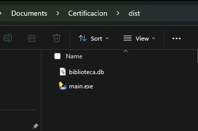

3. **Hacer doble clic en `main.exe`** para abrir el sistema. Puede tardar unos segundos en aparecer. Junto a la ventana del sistema se abrirá también una ventana negra: es normal y debe mantenerse abierta mientras se use el sistema (si se cierra, el sistema también se cierra).
4. **Primera vez:** si no existe el archivo `biblioteca.db`, el sistema crea uno vacío automáticamente y se puede empezar a registrar datos.
5. **(Opcional) Crear un acceso directo en el escritorio:** hacer clic derecho sobre `main.exe`, elegir *Enviar a* y luego *Escritorio (crear acceso directo)*. En Windows 11 primero se elige *Mostrar más opciones*.

**Consejos importantes**

- Si Windows muestra el aviso "Windows protegió su PC", es un aviso normal para programas que no reconoce. Hacer clic en *Más información* y luego en *Ejecutar de todos modos*.
- **No borrar ni cambiar de nombre el archivo `biblioteca.db`:** ahí se guarda toda la información. Si se mueve `main.exe` a otra carpeta, también debe moverse `biblioteca.db`.
- Para hacer una **copia de seguridad**, copiar `biblioteca.db` a otra carpeta o a una memoria USB.

---

## Guía de uso de las funciones básicas

### 1. Conocer la pantalla principal

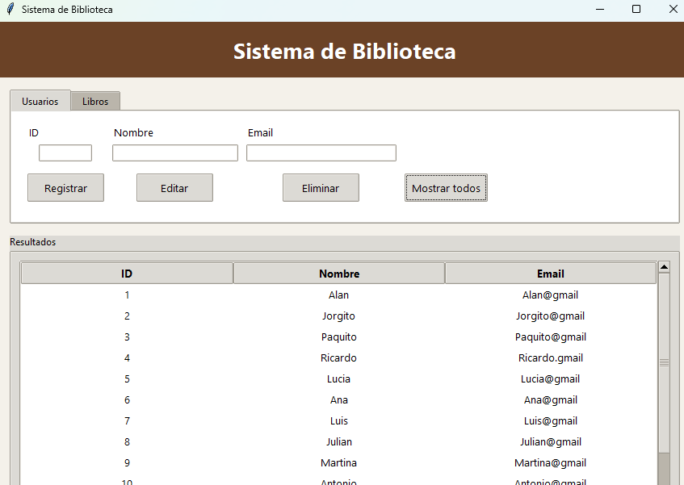

La pantalla tiene cuatro partes:

1. **Encabezado:** muestra el nombre del sistema.
2. **Pestañas:** *Usuarios* y *Libros*. Se hace clic en cada una para cambiar de sección.
3. **Campos y botones:** aquí se escriben los datos y se elige qué acción realizar.
4. **Resultados:** tabla donde se muestra la información.

> Al abrir el sistema la tabla aparece vacía. Para ver la información ya guardada, se presiona **Mostrar todos**.

### 2. Reglas importantes antes de empezar

- **ID:** cada usuario y cada libro tiene un número de ID que se elige al registrarlo. Es obligatorio, solo acepta números y puede tener hasta 5 dígitos.
- **El ID no se puede repetir.** Si se elimina un usuario o un libro, su ID queda libre y puede usarse de nuevo.
- **El nombre y el email** de los usuarios no se pueden repetir. Tampoco el **título** de los libros.
- Las mayúsculas y minúsculas no cuentan: "Ana" y "ana" se consideran iguales.
- Si hay dos ejemplares del mismo libro, deben distinguirse en el título, por ejemplo "Cien años de soledad (copia 2)".
- Al **editar**, el ID no se puede cambiar: se usa para indicar qué registro se desea modificar.
- Cuando un registro se guarda correctamente, los campos se limpian y la tabla se actualiza. Si algo no se puede hacer, aparece un **aviso** explicando por qué (ver la sección 5 de esta guía).

### 3. Usuarios

Seleccionar la pestaña **Usuarios**.

#### Registrar un usuario

1. Escribir el **ID**, el **Nombre** y el **Email**. Los tres son obligatorios.
2. Hacer clic en **Registrar**.
3. Los campos se limpian y la tabla muestra la lista de usuarios, con el nuevo incluido.

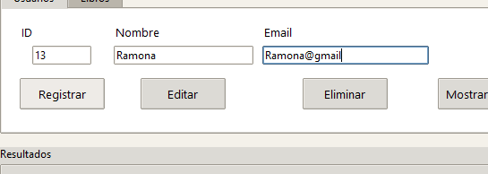

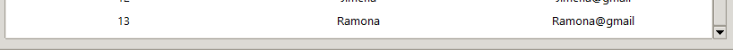

Si el ID, el nombre o el email ya existen, aparecerá un aviso y el usuario no se guardará.

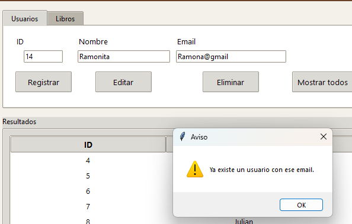

#### Consultar los usuarios

Hacer clic en **Mostrar todos**. La tabla muestra el ID, el nombre y el email de cada usuario, ordenados por ID de menor a mayor.

#### Editar un usuario

1. Escribir el **ID** del usuario que se desea modificar.
2. Escribir el **Nombre** y el **Email** nuevos (aunque uno de los dos no cambie, se debe escribir de nuevo).
3. Hacer clic en **Editar**.

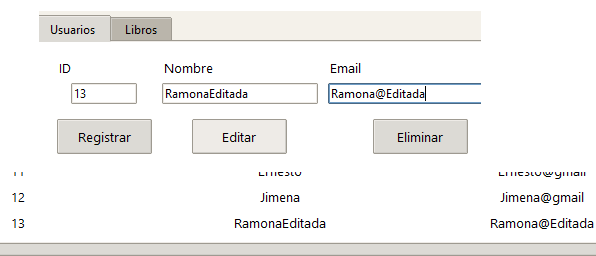

#### Eliminar un usuario

1. Escribir el **ID** del usuario que se desea eliminar.
2. Hacer clic en **Eliminar**.
3. El sistema pedirá confirmación. Hacer clic en **Sí** para continuar.

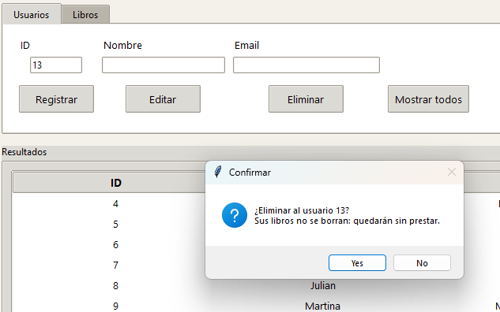

> Al eliminar un usuario **sus libros no se borran**: solo dejan de estar prestados y pasan a mostrarse como "Ninguno".

### 4. Libros

Seleccionar la pestaña **Libros**.

#### Registrar un libro (prestarlo a un usuario)

1. Escribir el **ID Libro**, el **Título**, el **Autor** y el **ID Usuario** de quien se lleva el libro. Los cuatro son obligatorios.
2. Hacer clic en **Registrar**.

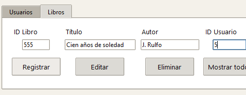

El usuario debe estar registrado antes. Si el ID Usuario no existe, aparecerá un aviso y el libro no se guardará.

#### Consultar los libros

Hacer clic en **Mostrar todos**. La tabla muestra el ID, el título, el autor y el ID del usuario que tiene el libro. Si el libro no está prestado, aparece **"Ninguno"**.

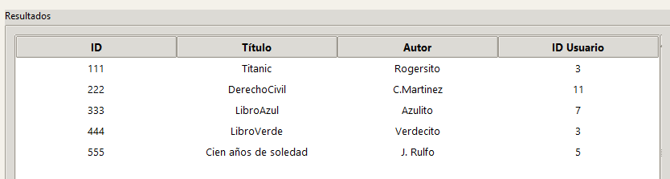

#### Editar un libro (cambiar datos, prestarlo o dejarlo sin prestar)

1. Escribir el **ID Libro** del libro que se desea modificar.
2. Escribir el **Título** y el **Autor** (aunque no cambien, se deben escribir de nuevo).
3. En **ID Usuario**:
   - escribir el ID de un usuario para **prestar** el libro o pasarlo a otra persona;
   - dejarlo **vacío** para dejar el libro **sin prestar** (en la tabla aparecerá como "Ninguno").
4. Hacer clic en **Editar**.

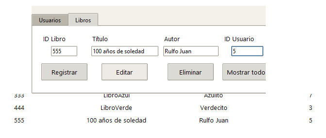

#### Eliminar un libro

1. Escribir el **ID Libro**.
2. Hacer clic en **Eliminar**.

> Atención: el libro se elimina de inmediato y esta acción no se puede deshacer.

#### Ver los libros de un usuario

1. Escribir el ID del usuario en el campo **ID Usuario**.
2. Hacer clic en **Filtrar por usuario**.

La tabla muestra solo los libros de ese usuario. Si la tabla queda vacía, ese usuario no tiene libros prestados (o el ID escrito no corresponde a ningún usuario).

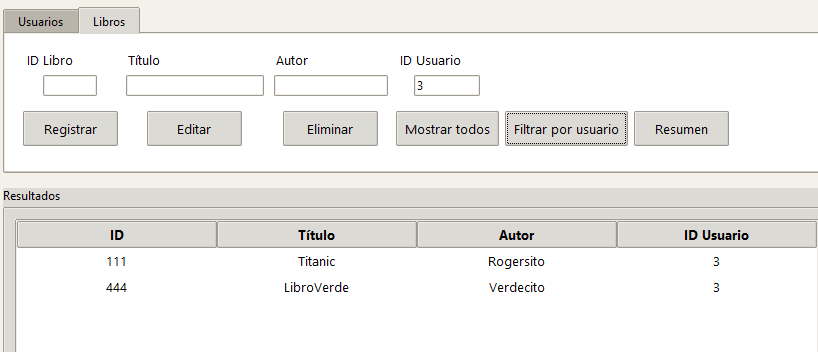

#### Ver el resumen de préstamos

Hacer clic en **Resumen**. La tabla muestra cada usuario con el **total de libros** que tiene prestados, incluidos los usuarios que no tienen ninguno.

<!-- 📸 CAPTURA 12: tabla con el resumen (columnas Usuario y Total de libros). Guardar como capturas/12_resumen.png -->
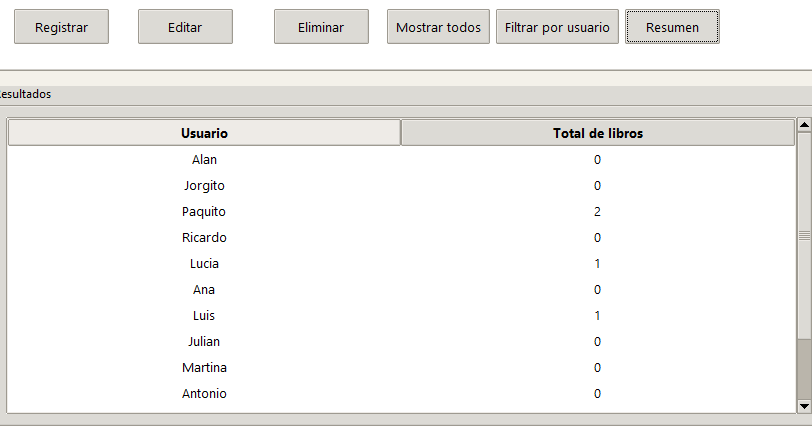

### 5. Avisos que puede mostrar el sistema

| Aviso | Qué significa | Qué hacer |
|---|---|---|
| "El ID … es obligatorio." | Se dejó un ID vacío. | Escribir el ID. |
| "Escribe nombre y email." / "Escribe el nombre y el email." / "Escribe título y autor." | Falta un dato obligatorio. | Completar todos los campos pedidos. |
| "Ya existe un usuario con ese ID / nombre / email." | Ese dato ya está registrado en otro usuario. | Usar un dato distinto. |
| "Ya existe un libro con ese ID / título." | Ese dato ya está registrado en otro libro. | Usar un dato distinto. |
| "Ya existe otro usuario con ese nombre / email." o "Ya existe otro libro con ese título." | Al editar, el dato pertenece a otro registro. | Usar un dato distinto. |
| "No existe un usuario con ese ID." / "No existe un libro con ese ID." | El ID escrito no está registrado. | Revisar el ID con **Mostrar todos**. |
| "El ID de usuario no existe." | Se intentó asignar un libro a un usuario que no está registrado. | Registrar primero al usuario o corregir el ID. |

---

## Glosario

- **Sistema:** el programa `main.exe` con el que se administra la biblioteca.
- **Usuario:** persona registrada en la biblioteca que puede llevarse libros prestados.
- **Libro:** obra registrada en la biblioteca, con su título y autor.
- **Préstamo:** libro que está asignado a un usuario.
- **ID:** número único que identifica a cada usuario o libro.
- **ID Usuario:** número del usuario que tiene un libro prestado.
- **Registro:** conjunto de datos guardados de un usuario o de un libro.
- **Campo:** espacio en blanco donde se escribe un dato.
- **Pestaña:** sección de la ventana que se elige con un clic (*Usuarios* o *Libros*).
- **Tabla de resultados:** zona de la ventana donde se muestra la información consultada.
- **Aviso:** mensaje que muestra el sistema cuando una acción no se puede realizar.
- **Filtrar:** mostrar solo los registros que cumplen una condición, por ejemplo los libros de un usuario.
- **Resumen:** lista con el total de libros que tiene prestados cada usuario.
- **Base de datos (`biblioteca.db`):** archivo donde el sistema guarda toda la información.
- **Ejecutable (`.exe`):** archivo que abre el sistema con doble clic, sin necesidad de instalar nada más.
- **Ninguno:** texto que indica que un libro no está prestado a nadie.